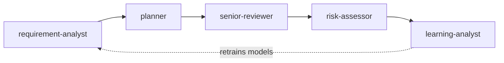

# DevLens

**Subagents that measure every stage of software delivery with ML/DL.**

Coding agents write fast, but they do not measure. DevLens gives them specialized subagents that decide from objective, explainable signals: how ambiguous a requirement is, which files a change will touch, whether new code duplicates existing logic or breaks the architecture, and how likely a pull request is to introduce a bug. Every signal comes from a model, and every verdict names the model that produced it.

> **Status:** Phase 1 in progress. `score_pull_request` and the `risk-assessor` subagent work today with a heuristic baseline; the trained XGBoost model comes next. See the [roadmap](#roadmap).

## How it works

DevLens has three layers ([ADR-003](docs/adr/003-subagent-architecture.md)):

| Layer | What it does | Where |
| --- | --- | --- |
| **Measure** | ML models compute risk, ambiguity, duplication and impact | Go MCP server in [`server/`](server/) |
| **Judge** | One subagent per stage reads the numbers and applies a written decision policy | [`agents/`](agents/) |
| **Run** | Skills give people a single entry point | [`skills/`](skills/) |



| Stage | Subagent | What it measures | Technique |
| --- | --- | --- | --- |
| Analyze | `requirement-analyst` | Ambiguity and complexity of a requirement | NLP classifier + story-point regression |
| Plan | `planner` | Files and modules likely impacted | Code embeddings + repository history |
| Implement | `senior-reviewer` | Duplicates, code smells, architecture violations | Code embeddings + smell classifier + static analysis |
| Review | `risk-assessor` | Probability that a PR introduces a bug, with reasons | XGBoost + diff embeddings + SHAP |
| Learn | `learning-analyst` | Real accuracy of estimates and predictions | Outcome log + periodic retraining |

Measurements decide; agents explain. The `risk-assessor`, for example, never says a PR is safe when the model says the risk is high: it turns the top reasons into concrete actions instead. Read the full [design document](docs/design.md) ([español](docs/es/diseno.md)).

## Quick start

Requirements: [Go](https://go.dev/dl/) 1.25 or newer and [Claude Code](https://code.claude.com/docs/en/overview).

### Install the plugin in Claude Code

```
/plugin marketplace add pfrancor17/devlens
/plugin install devlens@devlens
```

Then ask:

```
/devlens:assess-pr modelcontextprotocol/go-sdk#100
```

The `risk-assessor` subagent scores the pull request and answers with the risk, a verdict and the actions that lower it. Set a read-only GitHub token in the plugin's settings to raise GitHub's rate limit or read private repositories.

### Use the MCP server from any client

```bash
git clone https://github.com/pfrancor17/devlens.git
cd devlens/server
go test ./...
go build -o bin/devlens ./cmd/devlens
```

For Claude Desktop, add this to `claude_desktop_config.json` and restart the app:

```json
{
  "mcpServers": {
    "devlens": {
      "command": "/absolute/path/to/devlens/server/bin/devlens",
      "env": { "GITHUB_TOKEN": "optional-read-only-token" }
    }
  }
}
```

## Available today

| Component | Kind | Status |
| --- | --- | --- |
| `ping` | MCP tool | Available |
| `score_pull_request` | MCP tool | Available (heuristic baseline) |
| `risk-assessor` | Subagent | Available |
| `/devlens:assess-pr` | Skill | Available |
| `risky_files` | MCP tool | Phase 1 |
| `senior-reviewer`, `devlens-lead` | Subagents | Phase 2 |
| `requirement-analyst`, `planner`, `learning-analyst` | Subagents | Phases 3–5 |

## Roadmap

| Phase | Focus | Status |
| --- | --- | --- |
| 1 | Foundations, PR Risk Scorer and `risk-assessor` | In progress |
| 2 | Senior Reviewer and the `devlens-lead` orchestrator | Planned |
| 3 | Requirement Analyzer | Planned |
| 4 | Implementation Planner | Planned |
| 5 | Learning Loop | Planned |

## Repository layout

```
.claude-plugin/  Plugin manifest and marketplace
agents/          Subagents
skills/          Skills (entry points)
server/          Go MCP server (hexagonal: domain, use cases, ports, adapters)
ml/              Python training pipelines
contracts/       Feature contract shared by Python and Go
models/          Versioned ONNX models
docs/            Design document and ADRs
```

## Engineering standards

- Hexagonal architecture enforced by tests: the domain imports only the standard library.
- One feature contract for training and serving, checked by contract tests.
- Every model ships with a baseline comparison, published metrics and a minimum threshold in CI.
- Decision thresholds live in the domain, with tests, not in prompts.
- Decisions recorded as [ADRs](docs/adr/); conventional commits; semantic versioning.

## Author

**Patricia Franco Ruiz** — Software developer working on AI agents, MCP servers and ML-driven developer tooling. Medellín, Colombia.

## License

[MIT](LICENSE)
