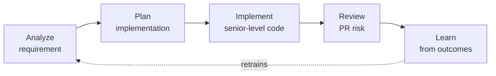

# DevLens

**An MCP server that measures every stage of software delivery with ML/DL.**

Coding agents write fast, but they do not measure. DevLens gives them objective, explainable signals at each step: how ambiguous a requirement is, which files a change will touch, whether new code duplicates existing logic or breaks the architecture, and how likely a pull request is to introduce a bug. Every signal comes from a trained and evaluated model, and the models keep learning from real outcomes.

> **Status:** Phase 1 in progress — foundations and PR Risk Scorer. See the [roadmap](#roadmap).

## How it works



| Module | What it measures | Technique |
| --- | --- | --- |
| Requirement Analyzer | Ambiguity and complexity of a requirement | NLP classifier + story-point regression |
| Implementation Planner | Files and modules likely impacted | Code embeddings + repository history |
| Senior Reviewer | Duplicates, code smells, architecture violations | Code embeddings + smell classifier + static analysis |
| PR Risk Scorer | Probability that a PR introduces a bug, with reasons | XGBoost + diff embeddings + SHAP |
| Learning Loop | Real accuracy of estimates and predictions | Outcome log + periodic retraining |

The server is written in **Go** with a hexagonal architecture; models are trained in **Python** and served through **ONNX**. Read the full [design document](docs/design.md) ([español](docs/es/diseno.md)) and the [architecture decisions](docs/adr/).

## Quick start

Requirements: [Go](https://go.dev/dl/) 1.25 or newer.

```bash
git clone https://github.com/pfrancor17/devlens.git
cd devlens/server
go test ./...
go build -o bin/devlens ./cmd/devlens
```

### Connect it to Claude Code

```bash
claude mcp add devlens -- "$(pwd)/bin/devlens"
```

Then ask Claude to *"call the DevLens ping tool"*. It answers with the server version and the state of each module.

### Connect it to Claude Desktop

Add this to your `claude_desktop_config.json` and restart the app:

```json
{
  "mcpServers": {
    "devlens": {
      "command": "/absolute/path/to/devlens/server/bin/devlens"
    }
  }
}
```

## Available tools

| Tool | Status |
| --- | --- |
| `ping` | Available |
| `score_pull_request`, `risky_files` | Phase 1 |
| `find_similar_code`, `review_quality`, `project_conventions` | Phase 2 |
| `analyze_requirement` | Phase 3 |
| `plan_implementation` | Phase 4 |
| `record_outcome`, `project_insights` | Phase 5 |

## Roadmap

| Phase | Focus | Status |
| --- | --- | --- |
| 1 | Foundations + PR Risk Scorer | In progress |
| 2 | Senior Reviewer | Planned |
| 3 | Requirement Analyzer | Planned |
| 4 | Implementation Planner | Planned |
| 5 | Learning Loop | Planned |

## Repository layout

```
server/      Go MCP server (hexagonal: domain, use cases, ports, adapters)
ml/          Python training pipelines
contracts/   Feature contract shared by Python and Go
models/      Versioned ONNX models
docs/        Design document and ADRs
```

## Engineering standards

- Hexagonal architecture enforced by tests: the domain imports only the standard library.
- One feature contract for training and serving, checked by contract tests.
- Every model ships with a baseline comparison, published metrics and a minimum threshold in CI.
- Decisions recorded as [ADRs](docs/adr/); conventional commits; semantic versioning.

## Author

**Patricia Franco Ruiz** — Software developer working on AI agents, MCP servers and ML-driven developer tooling. Medellín, Colombia.

## License

[MIT](LICENSE)
