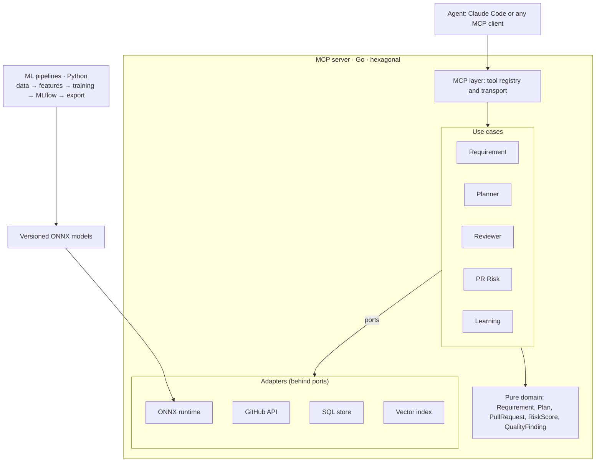
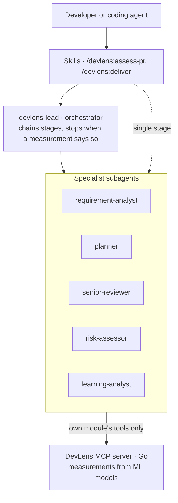

# DevLens — Design Document

*Last updated: 2026-10-26 · Author: Patricia Franco Ruiz · Spanish version: [docs/es/diseno.md](es/diseno.md)*

## 1. Vision

DevLens is a multi-agent system, delivered as a Claude Code plugin, that accompanies an AI agent through the whole delivery lifecycle: it analyzes the requirement, plans the implementation, demands senior-level code, scores the risk of every pull request and learns from real outcomes. Every stage has a specialized subagent whose decisions rest on a trained and evaluated ML or DL model, not only on an LLM answering.

**Problem.** Coding agents write fast, but they do not measure. They cannot tell whether a requirement is ambiguous, whether they are duplicating existing logic, whether they are breaking the architecture or whether a change is risky. DevLens gives them that objective measurement.

**What makes it different:**

- Measurement with purpose-built models (XGBoost, code embeddings, NLP classifiers) with published metrics.
- Explainability: every score comes with its reasons (SHAP).
- Specialized subagents that decide from measurements, not opinions (see section 4).
- Learning loop: models are retrained with each team's real outcomes.
- The repository itself is an example of senior-level code and reviews itself (dogfooding).
- Built from scratch on public data.

## 2. Scope: five modules

The full flow is **requirement → plan → senior implementation → risk review → learning**. Each module is usable on its own and adds value to the next one.

| Module | Stage | Subagent | What it measures | Main technique |
| --- | --- | --- | --- | --- |
| Requirement Analyzer | Analyze | `requirement-analyst` | Ambiguity and complexity of a requirement | NLP classifier + story-point regression (DL) |
| Implementation Planner | Plan | `planner` | Files and modules likely impacted, early risk | Code embeddings + repository history |
| Senior Reviewer | Implement | `senior-reviewer` | Duplicates, code smells, architecture violations, conventions | Embeddings (clones) + smell classifier + static analysis |
| PR Risk Scorer | Review | `risk-assessor` | Probability that a PR introduces a bug; deviation from the plan | XGBoost + diff embeddings, SHAP |
| Learning Loop | Learn | `learning-analyst` | Real accuracy of estimates and predictions | Outcome log + periodic retraining |

**Out of scope for now:** generating code (the agent does that), a full web UI, providers other than GitHub.

## 3. Architecture

The MCP server is written in Go with a hexagonal architecture. Training lives in Python, and the only bridge between both worlds is a set of models exported to ONNX plus a shared feature contract. Production never depends on Python, and every external piece can be replaced without touching the domain.



**Core decisions** (see [ADRs](adr/)):

- **Pure domain** at the center: entities and rules with standard-library imports only, enforced by a test.
- **Ports** (interfaces) for everything external: code repository, model predictor, result store, embedding index.
- **Swappable adapters:** GitHub API, ONNX runtime, SQLite/Postgres, vector index.
- **One feature contract** ([`contracts/features.yaml`](../contracts/features.yaml)) read by Python and Go, validated by contract tests.
- **Versioned model registry:** every model ships with its version, metrics and training date.

**Repository layout:**

```
devlens/
├── .claude-plugin/              # plugin manifest and marketplace
├── .mcp.json                    # starts the Go MCP server for the plugin
├── agents/                      # subagents (one per module + orchestrator)
├── skills/                      # entry points such as /devlens:assess-pr
├── server/                      # Go — MCP server
│   ├── cmd/devlens/             # entry point (stdio transport)
│   └── internal/
│       ├── domain/              # entities and pure rules
│       ├── usecase/             # one package per module
│       ├── port/                # driven ports (interfaces)
│       ├── adapter/             # github, onnx, store, vectorindex
│       └── mcpserver/           # driving adapter: MCP tools
├── ml/                          # Python — data and training
│   ├── pipelines/               # one pipeline per model
│   ├── features/                # feature contract implementation
│   └── evaluation/              # metrics and thresholds
├── contracts/features.yaml      # single source of truth for features
├── models/                      # .onnx + versioned metadata
├── docs/                        # design, ADRs
└── .github/workflows/           # CI
```

## 4. Agent layer: subagents that decide from measurements

DevLens has three layers ([ADR-003](adr/003-subagent-architecture.md)): the Go MCP server **measures**, the subagents **judge**, and the skills give people an **entry point**. Each subagent can call only its own module's tools, so it works with a small, focused context.



**Decision policies.** Every subagent carries a table that maps the model's level to a verdict and to what it must require. The `risk-assessor` policy:

| Level | Verdict | Requirement |
| --- | --- | --- |
| low | Ready for normal review | Nothing extra |
| medium | Review with focus | Name the 1–2 areas to review first |
| high | Not ready to merge | At least one concrete action that lowers risk |

The orchestrator applies the same idea across stages: high ambiguity returns clarifying questions instead of a plan; high PR risk sends the change back to implementation with the actions the reviewer named.

**Packaging.** The repository root is a Claude Code plugin: `.claude-plugin/plugin.json`, `.mcp.json` (starts the Go server), `agents/` and `skills/`. It installs with `/plugin marketplace add pfrancor17/devlens` and `/plugin install devlens@devlens`.

## 5. MCP tools

DevLens exposes nine tools. Every response includes the model version that produced it and the reasons behind the result.

| Tool | Module | Input | Output |
| --- | --- | --- | --- |
| `analyze_requirement` | Requirement Analyzer | requirement text | ambiguity (0–1), estimated complexity, vague phrases, suggested questions |
| `plan_implementation` | Implementation Planner | requirement, repo | impacted files with probability, step-by-step plan, early risks |
| `project_conventions` | Senior Reviewer | repo | inferred style guide: naming, errors, tests, structure |
| `find_similar_code` | Senior Reviewer | code snippet, repo | existing similar functions with their similarity |
| `review_quality` | Senior Reviewer | PR or diff | duplicates, code smells, layer violations, refactor suggestions |
| `score_pull_request` | PR Risk Scorer | repo, PR number | risk (0–1), top SHAP reasons, deviation from the plan |
| `risky_files` | PR Risk Scorer | repo | files with the highest historical risk |
| `record_outcome` | Learning Loop | PR, real outcome (bug yes/no, real effort) | confirmation |
| `project_insights` | Learning Loop | repo | historical accuracy of estimates and predictions, trends |

A `ping` tool reports that the server is running and the state of each module. `score_pull_request` is available today with a heuristic baseline model (`pr-risk-heuristic`) that the trained XGBoost model replaces behind the same port.

Example `score_pull_request` response:

```json
{
  "risk": 0.72,
  "level": "high",
  "model": "pr-risk-xgb@1.3.0",
  "reasons": [
    {"feature": "files_with_bug_history", "impact": 0.21},
    {"feature": "lines_added", "impact": 0.14},
    {"feature": "tests_modified", "impact": -0.05}
  ],
  "plan_deviation": ["internal/payments/gateway.go was not in the plan"]
}
```

## 6. ML/DL models

Five models, each with a simple baseline and an improved version; the comparison between both is always published. Datasets are candidates: availability and license must be confirmed before use.

| Model | Baseline | Improved version | Candidate dataset | Main metric |
| --- | --- | --- | --- | --- |
| PR Risk | Logistic regression | XGBoost + diff embeddings (CodeBERT/UniXcoder) | ApacheJIT; own labels via SZZ | ROC-AUC, recall on the buggy class |
| Clones / duplicates | Token similarity | Function embeddings + vector search | BigCloneBench, POJ-104 (CodeXGLUE) | Precision@k, F1 |
| Code smells | Metric thresholds (LOC, complexity) | Classifier on metrics + embeddings | MLCQ | F1 per smell type |
| Requirement complexity | Per-project mean | Regressor on text embeddings | Deep-SE story-point dataset | MAE |
| Requirement ambiguity | Vague-term list | Fine-tuned text classifier | Public requirements + own labeling | F1 |

**Validation rules:**

- **Temporal split** for anything with a date (commits, issues): train on the past, evaluate on the future.
- Imbalanced classes: report recall and PR-AUC, not only accuracy.
- Every model has a **minimum threshold** in CI: if the metric drops below it, the pipeline fails.
- Every run is logged in MLflow with data, parameters, metrics and the ONNX artifact.

Target metrics are set after each phase's baseline, not before: measure first, promise later.

## 7. Senior-level quality standards

The repository is treated as a product: no phase closes without meeting these standards, and from phase 2 on DevLens reviews its own pull requests.

**Code**

- Strict hexagonal architecture: the domain never imports adapters; enforced by a dependency test in CI.
- Zero redundancy: shared logic lives in one place; `find_similar_code` runs on every PR of this repository.
- Short functions, names that state intent, errors wrapped with context (`fmt.Errorf("...: %w", err)`).
- Configuration through environment variables; no secrets in code.

**Tests**

- Unit tests for domain and use cases with fake adapters.
- Adapter integration tests (GitHub with recorded responses, ONNX with a small test model).
- Feature contract tests: same inputs, same outputs in Python and Go.
- Model evaluation with minimum thresholds.

**Automation**

- GitHub Actions: `golangci-lint`, `ruff`, `mypy`, tests, coverage, build and model evaluation.
- Conventional commits, a `CHANGELOG` per phase, semantic versioning.
- Dogfooding: DevLens comments risk and quality on every PR of this repository.

**Documentation**

- ADRs in [`docs/adr/`](adr/) for every relevant decision (context, decision, consequences).
- README with diagram, demo, current metrics and a setup guide under 5 minutes.

## 8. Roadmap

The full project takes 14–17 weeks at 8–10 hours per week. Each phase closes demonstrable before the next one opens. The Senior Reviewer comes second so DevLens can review its own code while the remaining phases are built.

| Phase | Focus | Duration | Done when |
| --- | --- | --- | --- |
| 1 | PR Risk Scorer + foundations: hexagonal repo, CI, ADRs, Go MCP server, plugin with `risk-assessor`, XGBoost model in ONNX | 3–4 weeks | `risk-assessor` gives a verdict with SHAP reasons on a real PR and the AUC is published |
| 2 | Senior Reviewer + `devlens-lead` orchestrator: embedding-based duplicates, code smells, architecture guard, repo conventions | 3–4 weeks | DevLens comments quality and risk on its own PRs |
| 3 | Requirement Analyzer: ambiguity classifier and complexity regressor | 3 weeks | `analyze_requirement` responds with published F1 and MAE |
| 4 | Implementation Planner: repo embedding index, impacted files, step-by-step plan | 3 weeks | The plan is compared against the real PR and the deviation is reported |
| 5 | Learning Loop: `record_outcome`, periodic retraining, `project_insights` | 2–3 weeks | A model retrained on real outcomes with its improvement measured |

## 9. Risks and open decisions

The main risk is scope: five modules are a lot, so each phase must close demonstrable before the next one opens.

| Risk | Impact | Mitigation |
| --- | --- | --- |
| Uncontrolled scope growth | Unfinished project | Phases with a definition of done; new ideas go to a backlog |
| Features computed differently in Python and Go | Silently wrong predictions | Single contract and contract tests in CI |
| Noisy labels (SZZ, smells) | Inflated or misleading metrics | Document limitations; validate with hand-reviewed samples |
| Datasets with restrictive licenses | Cannot publish | Check licenses before use; prefer open data |
| Heavy DL models for Go | Slow inference | Small models, quantization and embedding cache |

**Open decisions:**

- [ ] Vector index: pgvector, Qdrant or one embedded in Go.
- [ ] Result store: SQLite to start or Postgres from day one.
