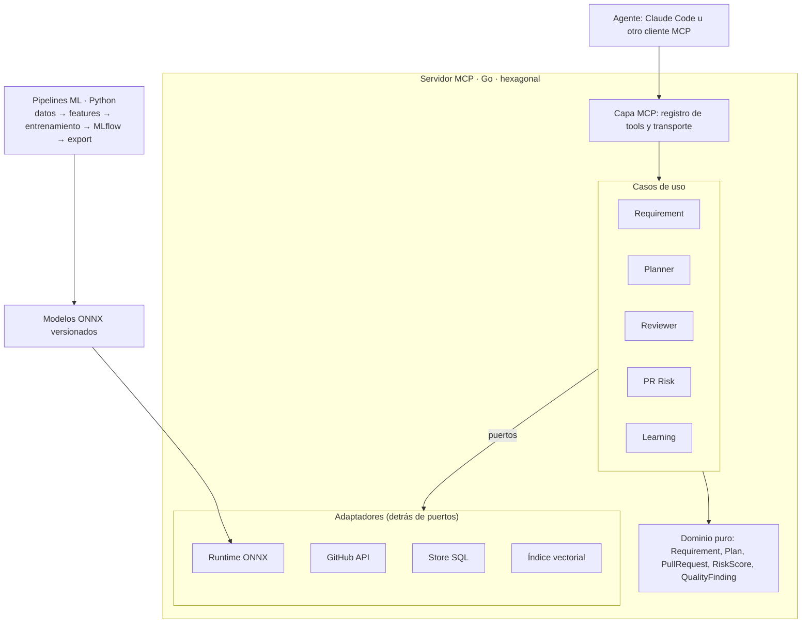
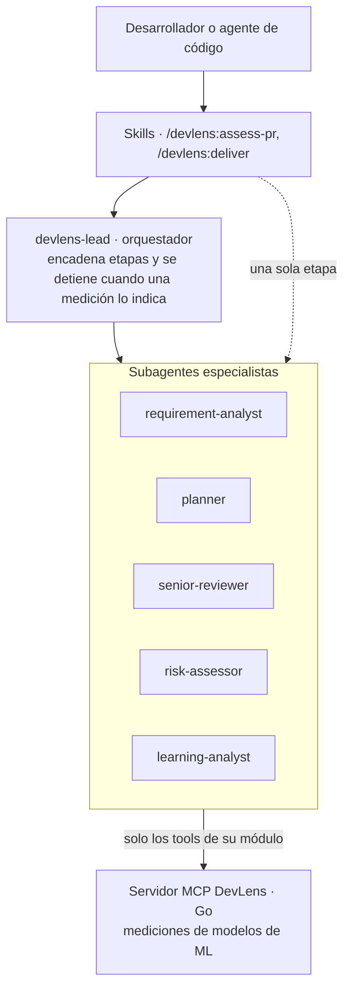

# DevLens — Documento de diseño

*Última actualización: 2026-10-26 · Autora: Patricia Franco Ruiz · Versión en inglés: [docs/design.md](../design.md)*

## 1. Visión

DevLens es un sistema multiagente, entregado como plugin de Claude Code, que acompaña a un agente de IA en todo el ciclo de un proyecto: analiza el requerimiento, planea la implementación, exige código de nivel senior, mide el riesgo de cada PR y aprende de los resultados reales. Cada etapa tiene un subagente especializado cuyas decisiones se apoyan en un modelo de ML o DL entrenado y evaluado, no solo en un LLM respondiendo.

**Problema que resuelve.** Los agentes de código escriben rápido, pero no miden: no saben si un requerimiento es ambiguo, si están duplicando lógica existente, si rompen la arquitectura o si un cambio es riesgoso. DevLens les da esa medición objetiva.

**Diferenciadores:**

- Medición con modelos propios (XGBoost, embeddings de código, clasificadores NLP) con métricas publicadas.
- Explicabilidad: cada puntaje viene con sus razones (SHAP).
- Subagentes especializados que deciden con mediciones, no con opiniones (ver sección 4).
- Bucle de aprendizaje: los modelos se reentrenan con los resultados reales de cada equipo.
- El propio repo es ejemplo de código senior y se revisa a sí mismo (dogfooding).
- Construido desde cero con datos públicos.

## 2. Alcance: los cinco módulos

El flujo completo es **requerimiento → plan → implementación senior → revisión de riesgo → aprendizaje**. Cada módulo es usable solo y suma valor al siguiente.

| Módulo | Etapa | Subagente | Qué mide | Técnica principal |
| --- | --- | --- | --- | --- |
| Requirement Analyzer | Analizar | `requirement-analyst` | Ambigüedad y complejidad del requerimiento | Clasificador NLP + regresión de story points (DL) |
| Implementation Planner | Planear | `planner` | Archivos y módulos impactados, riesgo anticipado | Embeddings de código + historial del repo |
| Senior Reviewer | Implementar | `senior-reviewer` | Duplicados, code smells, violaciones de arquitectura, convenciones | Embeddings (clones) + clasificador de smells + análisis estático |
| PR Risk Scorer | Revisar | `risk-assessor` | Probabilidad de que el PR introduzca un bug; desviación del plan | XGBoost + embeddings de diff, SHAP |
| Learning Loop | Aprender | `learning-analyst` | Precisión real de estimaciones y predicciones | Registro de resultados + reentrenamiento periódico |

**Fuera de alcance (por ahora):** generar código por sí mismo (eso lo hace el agente), interfaz web completa, proveedores distintos de GitHub.

## 3. Arquitectura

El servidor MCP se escribe en Go con arquitectura hexagonal; el entrenamiento vive en Python, y el único puente entre ambos son los modelos exportados a ONNX y un contrato de features compartido. Producción nunca depende de Python y cada pieza externa se reemplaza sin tocar el dominio.



**Decisiones base** (ver [ADRs](../adr/)):

- **Dominio puro** en el centro: entidades y reglas que solo importan la librería estándar, validado con un test.
- **Puertos** (interfaces) para todo lo externo: repositorio de código, predictor de modelos, almacén de resultados, índice de embeddings.
- **Adaptadores** intercambiables: GitHub API, runtime ONNX, SQLite/Postgres, índice vectorial.
- **Un solo contrato de features** ([`contracts/features.yaml`](../../contracts/features.yaml)) que leen Python y Go, validado con tests de contrato.
- **Registro de modelos** versionado: cada modelo trae su versión, métricas y fecha de entrenamiento.

**Estructura del repo:**

```
devlens/
├── .claude-plugin/              # manifiesto del plugin y marketplace
├── .mcp.json                    # arranca el servidor MCP en Go para el plugin
├── agents/                      # subagentes (uno por módulo + orquestador)
├── skills/                      # puntos de entrada como /devlens:assess-pr
├── server/                      # Go — servidor MCP
│   ├── cmd/devlens/             # punto de entrada (transporte stdio)
│   └── internal/
│       ├── domain/              # entidades y reglas puras
│       ├── usecase/             # un paquete por módulo
│       ├── port/                # puertos (interfaces)
│       ├── adapter/             # github, onnx, store, vectorindex
│       └── mcpserver/           # adaptador de entrada: tools MCP
├── ml/                          # Python — datos y entrenamiento
│   ├── pipelines/               # un pipeline por modelo
│   ├── features/                # implementación del contrato
│   └── evaluation/              # métricas y umbrales
├── contracts/features.yaml      # fuente única de verdad
├── models/                      # .onnx + metadata versionada
├── docs/                        # diseño y ADRs
└── .github/workflows/           # CI
```

## 4. Capa de agentes: subagentes que deciden con mediciones

DevLens tiene tres capas ([ADR-003](../adr/003-subagent-architecture.md)): el servidor MCP en Go **mide**, los subagentes **juzgan** y las skills son el **punto de entrada** para las personas. Cada subagente solo puede usar los tools de su módulo, así trabaja con un contexto pequeño y enfocado.



**Políticas de decisión.** Cada subagente tiene una tabla que convierte el nivel del modelo en un veredicto y en lo que debe exigir. La política del `risk-assessor`:

| Nivel | Veredicto | Exigencia |
| --- | --- | --- |
| low | Listo para revisión normal | Nada adicional |
| medium | Revisar con foco | Nombrar las 1–2 áreas a revisar primero |
| high | No está listo para merge | Al menos una acción concreta que baje el riesgo |

El orquestador aplica la misma idea entre etapas: una ambigüedad alta devuelve preguntas en lugar de un plan, y un riesgo alto en el PR regresa el cambio a implementación con las acciones que nombró el revisor.

**Empaquetado.** La raíz del repo es un plugin de Claude Code: `.claude-plugin/plugin.json`, `.mcp.json` (arranca el servidor en Go), `agents/` y `skills/`. Se instala con `/plugin marketplace add pfrancor17/devlens` y `/plugin install devlens@devlens`.

## 5. Tools MCP

DevLens expone nueve tools; cada respuesta incluye la versión del modelo que la produjo y las razones del resultado.

| Tool | Módulo | Entrada | Salida |
| --- | --- | --- | --- |
| `analyze_requirement` | Requirement Analyzer | texto del requerimiento | ambigüedad (0–1), complejidad estimada, frases vagas, preguntas sugeridas |
| `plan_implementation` | Implementation Planner | requerimiento, repo | archivos impactados con probabilidad, plan por pasos, riesgos anticipados |
| `project_conventions` | Senior Reviewer | repo | guía de estilo inferida: naming, errores, tests, estructura |
| `find_similar_code` | Senior Reviewer | fragmento de código, repo | funciones similares existentes con su similitud |
| `review_quality` | Senior Reviewer | PR o diff | duplicados, code smells, violaciones de capas, sugerencias de refactor |
| `score_pull_request` | PR Risk Scorer | repo, número de PR | riesgo (0–1), top razones SHAP, desviación del plan |
| `risky_files` | PR Risk Scorer | repo | archivos con mayor riesgo histórico |
| `record_outcome` | Learning Loop | PR, resultado real (bug sí/no, esfuerzo real) | confirmación del registro |
| `project_insights` | Learning Loop | repo | precisión histórica de estimaciones y predicciones, tendencias |

El tool `ping` confirma que el servidor está vivo y reporta el estado de cada módulo. `score_pull_request` ya está disponible con un modelo baseline heurístico (`pr-risk-heuristic`), que el modelo XGBoost entrenado reemplazará detrás del mismo puerto.

Ejemplo de respuesta de `score_pull_request`:

```json
{
  "risk": 0.72,
  "level": "high",
  "model": "pr-risk-xgb@1.3.0",
  "reasons": [
    {"feature": "files_with_bug_history", "impact": 0.21},
    {"feature": "lines_added", "impact": 0.14},
    {"feature": "tests_modified", "impact": -0.05}
  ],
  "plan_deviation": ["internal/payments/gateway.go no estaba en el plan"]
}
```

## 6. Modelos ML/DL

Son cinco modelos, cada uno con un baseline simple y una versión mejorada; se publica siempre la comparación entre ambos. Los datasets son candidatos: hay que confirmar disponibilidad y licencia antes de usarlos.

| Modelo | Baseline | Versión mejorada | Dataset candidato | Métrica principal |
| --- | --- | --- | --- | --- |
| PR Risk | Regresión logística | XGBoost + embeddings del diff (CodeBERT/UniXcoder) | ApacheJIT; etiquetas propias con SZZ | AUC-ROC, recall de clase buggy |
| Clones / duplicados | Similitud de tokens | Embeddings de funciones + búsqueda vectorial | BigCloneBench, POJ-104 (CodeXGLUE) | Precisión@k, F1 |
| Code smells | Umbrales de métricas (LOC, complejidad) | Clasificador sobre métricas + embeddings | MLCQ | F1 por tipo de smell |
| Complejidad del requerimiento | Media por proyecto | Regresor sobre embeddings del texto | Dataset de story points de Deep-SE | MAE |
| Ambigüedad del requerimiento | Lista de términos vagos | Clasificador de texto fine-tuned | Requerimientos públicos + etiquetado propio | F1 |

**Reglas de validación:**

- Split **temporal** para todo lo que tenga fecha (commits, issues): se entrena con el pasado y se evalúa con el futuro.
- Clases desbalanceadas: se reporta recall y PR-AUC, no solo accuracy.
- Cada modelo tiene un **umbral mínimo** en CI: si la métrica cae por debajo, el pipeline falla.
- Toda corrida queda registrada en MLflow con datos, parámetros, métricas y artefacto ONNX.

Las métricas objetivo se fijan después del baseline de cada fase, no antes: primero se mide, luego se promete.

## 7. Estándares de calidad nivel senior

El repo se trata como producto: ninguna fase se cierra si no cumple estos estándares, y desde la fase 2 DevLens revisa sus propios PRs.

**Código**

- Arquitectura hexagonal estricta: el dominio no importa adaptadores; se valida con un test de dependencias en CI.
- Cero redundancia: lógica compartida en un solo lugar; `find_similar_code` corre sobre cada PR del propio repo.
- Funciones cortas, nombres que expliquen intención, errores envueltos con contexto (`fmt.Errorf("...: %w", err)`).
- Configuración por variables de entorno, sin secretos en el código.

**Pruebas**

- Unitarias del dominio y casos de uso con adaptadores falsos.
- Integración de adaptadores (GitHub con respuestas grabadas, ONNX con un modelo pequeño de prueba).
- Contrato de features: mismas entradas, mismas salidas en Python y Go.
- Evaluación de modelos con umbrales mínimos.

**Automatización**

- GitHub Actions: `golangci-lint`, `ruff`, `mypy`, tests, cobertura, build y evaluación de modelos.
- Commits convencionales, `CHANGELOG` por fase, versionado semántico.
- Dogfooding: DevLens comenta riesgo y calidad en cada PR del repo.

**Documentación**

- ADRs en [`docs/adr/`](../adr/) para cada decisión relevante (contexto, decisión, consecuencias).
- README con diagrama, demo, métricas actuales y guía de instalación en menos de 5 minutos.

## 8. Roadmap

El proyecto completo toma entre 14 y 17 semanas a un ritmo de 8–10 horas semanales. Cada fase se cierra demostrable antes de abrir la siguiente. El Senior Reviewer va en la fase 2 para que DevLens revise su propio código mientras se construyen las fases siguientes.

| Fase | Enfoque | Duración | Terminada cuando |
| --- | --- | --- | --- |
| 1 | PR Risk Scorer + cimientos: repo hexagonal, CI, ADRs, servidor MCP en Go, plugin con `risk-assessor`, modelo XGBoost en ONNX | 3–4 semanas | `risk-assessor` da un veredicto con razones SHAP sobre un PR real y la AUC está publicada |
| 2 | Senior Reviewer + orquestador `devlens-lead`: duplicados por embeddings, code smells, guardián de arquitectura, convenciones del repo | 3–4 semanas | DevLens comenta calidad y riesgo en sus propios PRs |
| 3 | Requirement Analyzer: clasificador de ambigüedad y regresor de complejidad | 3 semanas | `analyze_requirement` responde con F1 y MAE publicados |
| 4 | Implementation Planner: índice de embeddings del repo, archivos impactados, plan por pasos | 3 semanas | El plan se compara contra el PR real y se reporta la desviación |
| 5 | Learning Loop: `record_outcome`, reentrenamiento periódico, `project_insights` | 2–3 semanas | Un modelo reentrenado con resultados reales y su mejora medida |

## 9. Riesgos y decisiones abiertas

El mayor riesgo es el alcance: cinco módulos son mucho, así que cada fase debe cerrarse demostrable antes de abrir la siguiente.

| Riesgo | Impacto | Mitigación |
| --- | --- | --- |
| Alcance que crece sin control | Proyecto sin terminar | Fases con criterio de terminado; ideas nuevas a un backlog |
| Features distintas en Python y Go | Predicciones erróneas en silencio | Contrato único y tests de contrato en CI |
| Etiquetas ruidosas (SZZ, smells) | Métricas infladas o engañosas | Documentar limitaciones; validar con muestras revisadas a mano |
| Datasets con licencia restrictiva | No poder publicar | Verificar licencia antes de usar; preferir datos abiertos |
| Modelos DL pesados para Go | Inferencia lenta | Modelos pequeños, cuantización y caché de embeddings |

**Decisiones abiertas:**

- [ ] Índice vectorial: pgvector, Qdrant o uno embebido en Go.
- [ ] Base de datos de resultados: SQLite para empezar o Postgres desde el inicio.
